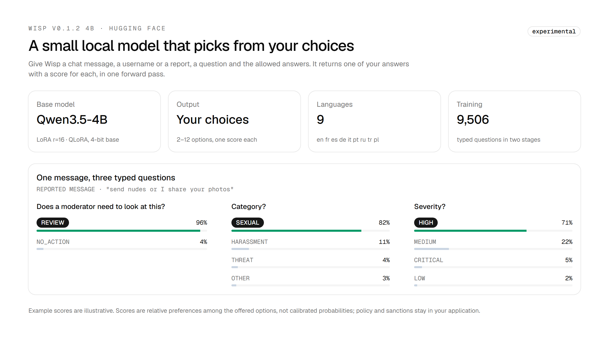
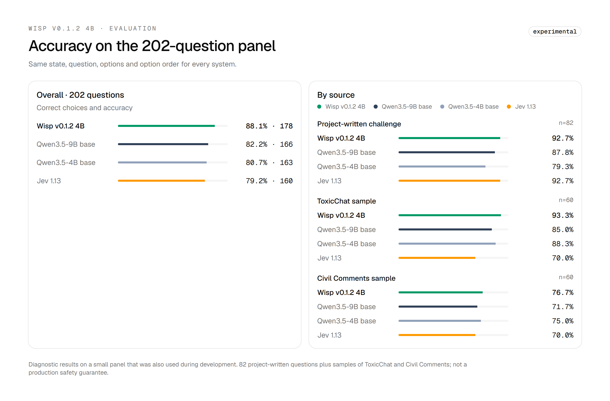

# Wisp

[](https://github.com/notnotebox/wisp/actions/workflows/ci.yml) [](LICENSE) [](https://huggingface.co/notebox/Wisp-v0.1.2-4B)

**A small moderation decision model: it picks one of your options, with a score for each, in one forward pass.**

Wisp v0.1.2 4B is a LoRA adapter on [`Qwen/Qwen3.5-4B`](https://huggingface.co/Qwen/Qwen3.5-4B). You give it a chat message, a username or a report, a question and the allowed answers. It does not write text: it reads the logits of your options and returns the best one with relative scores. Your application keeps the policy and decides what to do with the result.

> **Experimental release.** v0.1.2 is Wisp's first public release. The trained adapter, Rust runtime, and evaluation results provide a working baseline. The limitations below are known and will guide further work on coverage, calibration, and deployment. Wisp is ready to explore and integrate, with moderation policy and enforcement kept in the host application.



- **Model:** [`notebox/Wisp-v0.1.2-4B`](https://huggingface.co/notebox/Wisp-v0.1.2-4B) on Hugging Face (adapter, model card, full evaluation).
- **Languages:** English, French, Spanish, German, Italian, Portuguese, Russian, Turkish, Polish.
- **Typed questions:** review or no action, violation category, severity, action under a written server policy, moderator issue and priority, usernames, report validity.
- **Runtimes:** the native Rust/Candle server ([`rust/`](rust)) is the main one (tested on Windows with CUDA); a Python package and server ([`packages/wisp-decide`](packages/wisp-decide)) is a secondary option.
- **Demo site:** [Wisp Benchmark](https://github.com/notnotebox/wisp-benchmark), to compare Wisp with other models on the same request.
- **Status:** experimental; known failure modes and uncalibrated scores are documented in [Limits](#limits).

## Why Wisp

Wisp is a compact, open-source model made to run on your own machine, so the text you moderate does not have to go to a cloud service. Its focus is specialized bounded-choice moderation, local deployment and policies controlled by the integrating application. v0.1.2 establishes the first measured implementation of that direction; later releases will improve coverage, calibration and runtime support.

## Results

| System | Correct on the 202-question panel |
|---|---:|
| **Wisp v0.1.2 4B** | **178 (88.1%)** |
| Qwen3.5-9B base | 166 (82.2%) |
| Qwen3.5-4B base | 163 (80.7%) |
| Jev 1.13 | 160 (79.2%) |

Same state, question, options and option order for every system. The panel mixes 82 project-written questions with samples of ToxicChat and Civil Comments (a subset of an earlier 234-question panel, restricted to moderation questions). It was also used to compare candidate adapters during development; the fresh 107-question check below was written afterwards.

A second panel of **107 new questions**, written after the adapter was frozen and run once, gives **98/107 (91.6%)** for Wisp against 81/107 (75.7%) for the base model with the adapter switched off. The panel is not published. Its misses are listed in the model card: mild directed insults are the main one. Full tables, by-task results, latency and caveats are in the [model card](https://huggingface.co/notebox/Wisp-v0.1.2-4B).



## Rust runtime (main)

[`rust/`](rust) is a Rust server built on [Candle](https://github.com/huggingface/candle) that loads the adapter merged into the base weights (BF16) and serves `/decide`, `/v1/moderate`, `/v1/username`, `/v1/models` and `/health`. It needs no Python at inference time.

```powershell
hf download notebox/Wisp-v0.1.2-4B --local-dir models\wisp-v0.1.2-4b
.\scripts\prepare_candle.ps1      # merges the adapter and builds the server
.\scripts\start_candle.ps1        # serves on http://127.0.0.1:8782
```

The measured setup was Windows with CUDA; other environments have not yet been validated. In a fixed check on 8 short cases, Python and Candle selected the same option on 7. On the same 8 requests, with the GPU otherwise idle, Candle took about 83 ms per decision on average against about 136 ms for the Python package. These small, machine-specific checks are not a general compatibility or throughput guarantee. See the [Hugging Face model page](https://huggingface.co/notebox/Wisp-v0.1.2-4B) for release details and [`docs/RUST_RUNTIME.md`](docs/RUST_RUNTIME.md) for setup notes and measurement limits.

## Python package (secondary)

```bash
hf download notebox/Wisp-v0.1.2-4B --include "wisp-decide/*" --local-dir .
pip install "./wisp-decide[model]"
```

```python
import wisp_decide

wisp = wisp_decide.load("notebox/Wisp-v0.1.2-4B")
d = wisp.decide("Mira: he told me \"you are trash\" again, can a mod check?",
                "Does a moderator need to look at this?", ["REVIEW", "NO_ACTION"], task="moderation")
print(d.decision, d.probabilities, d.needs_review)
```

A secondary option for machines where the Rust server cannot run. It requires Python 3.10 or newer and loads the base model in 4-bit; actual performance depends on the hardware and configuration. The package lives in [`packages/wisp-decide`](packages/wisp-decide).

### HTTP server

```bash
wisp-decide serve
```

The Python server defaults to `127.0.0.1:8781`; the native Candle server defaults to `127.0.0.1:8782`.

Two request formats on the same server:

```json
{"task": "moderation", "text": "...", "question": "Does a moderator need to look at this?", "options": ["REVIEW", "NO_ACTION"]}
```

`POST /decide` takes the format above. `POST /v1/systemone` takes the request shape of the Jev / TypeSafe protocol (`state` plus named `questions`, types `noul` and `choice`), so a client written for that format only needs a different base URL. The route follows the published shape and is tested against this server, not against the vendors' own client libraries. `GET /v1/models` and `GET /health` describe the running model.

## How it works

The prompt has four blocks: `CONTEXT` (the rule or policy to apply), `STATE`, `QUESTION`, `OPTIONS`. Each option gets a one-token symbol (`A`, `B`, `C`…). One forward pass reads the logits of those symbols at the next position, and a softmax over them gives the scores, so the answer is always one of the offered options.

```text
CONTEXT   server policy or built-in rule
STATE     chat message, username or report
QUESTION  "Does a moderator need to look at this?"
OPTIONS   A. REVIEW   B. NO_ACTION        →  logits of A, B  →  decision + scores
```

The scores are relative preferences among the options shown, not calibrated probabilities. `needs_review` is a convenience flag set when the best score is under 0.7. `REVIEW` means "send this case to your review path"; it never authorizes a sanction.

The training data was generated for the project, with a precise method: parts of it were reviewed by humans, including randomly selected samples checked on purpose to verify reliability, and the datasets and the generation prompts were corrected several times along the way. The adapter was trained in two stages on 9,506 typed questions in 9 languages (QLoRA, r=16). The model card describes the data format, the 13 question families and the source buckets. Raw and formatted training rows and evaluation panels are not published.

## Wisp Benchmark (demo site)

[Wisp Benchmark](https://github.com/notnotebox/wisp-benchmark) is a local-first web app to compare two decision systems on exactly the same request: Wisp (through the Rust server or `wisp-decide`), a model served by Ollama, any OpenAI-compatible endpoint, or a model reached through OpenRouter. You define closed-choice questions and options, run the same request on both sides, and compare decisions, relative scores, disagreements, latency and review flags. It is an interface, not an inference host: model weights stay on your machine.

## Built with

| Part | Technology |
|---|---|
| Base model | [Qwen3.5-4B](https://huggingface.co/Qwen/Qwen3.5-4B) |
| Fine-tuning | [LoRA](https://arxiv.org/abs/2106.09685) and [QLoRA](https://arxiv.org/abs/2305.14314) with [PyTorch](https://pytorch.org), [Transformers](https://github.com/huggingface/transformers), [PEFT](https://github.com/huggingface/peft) and [bitsandbytes](https://github.com/bitsandbytes-foundation/bitsandbytes) |
| Weights format | [safetensors](https://github.com/huggingface/safetensors) |
| Main runtime | [Rust](https://www.rust-lang.org) with [Candle](https://github.com/huggingface/candle), [axum](https://github.com/tokio-rs/axum), [tokio](https://tokio.rs) and [tokenizers](https://github.com/huggingface/tokenizers) |
| Secondary runtime (Python) | `wisp-decide`: Transformers + PEFT, 4-bit base, standard-library HTTP server |
| Demo site | [Wisp Benchmark](https://github.com/notnotebox/wisp-benchmark), built with [Next.js](https://nextjs.org), [React](https://react.dev), [Tailwind CSS](https://tailwindcss.com), [shadcn/ui](https://ui.shadcn.com) and [Base UI](https://base-ui.com) |
| Distribution | [Hugging Face Hub](https://huggingface.co/notebox/Wisp-v0.1.2-4B) |

Training and evaluation data: [CONDA](https://huggingface.co/datasets/Matrix430/CONDA), [Aegis 2.0](https://huggingface.co/datasets/nvidia/Aegis-AI-Content-Safety-Dataset-2.0), roots from [LDNOOBW](https://github.com/LDNOOBW/List-of-Dirty-Naughty-Obscene-and-Otherwise-Bad-Words) for training, and [ToxicChat](https://huggingface.co/datasets/lmsys/toxic-chat) and [Civil Comments](https://huggingface.co/datasets/google/civil_comments) for evaluation only, plus project-written scenarios. Licences are listed in the model card.

## Repository layout

```text
rust/                   Main runtime: native Rust/Candle server, with the pinned Candle source
packages/wisp-decide/   Secondary runtime: Python package and HTTP server (pip-installable)
scripts/                Build and run helpers for the Rust runtime
docs/                   Rust runtime notes and figures
```

## Limits

- Mild directed insults are under-flagged (seen on the fresh 107-question panel), and some disguised or abbreviated abuse is missed.
- Slang, code-switching, reclaimed language, quotations and local community norms cause errors in every language.
- Context is limited to the few previous messages given in the state; long conversations were not trained.
- Scores are not calibrated; calibrate on your own data before using a threshold.
- The training labels were generated for this project with AI assistance; parts of it were reviewed by humans (including random samples checked on purpose), not every row was reviewed, and nothing was independently adjudicated.
- Wisp was not trained on rating scales; use `choice` and yes/no questions.
- It is a decision aid for a review path, not a filter that should act alone.

## What Wisp does not do

Wisp is not trained on any operator's private server data, publishes no raw training rows, and applies no automatic sanction.

## Credits

Wisp is built on Qwen3.5-4B. Its request shape for typed questions follows the System One / Jev protocol from TypeSafe AI, and the candidate-logit readout draws on techniques shown in other Qwen projects. Wisp does not claim to reproduce any proprietary architecture, training method or performance claim. The vendored Candle sources keep their own licences (Apache-2.0 and MIT) in `rust/vendor/candle`.

## Contributing

Issues and pull requests are welcome, see [CONTRIBUTING.md](CONTRIBUTING.md).

## License

Apache-2.0, see [LICENSE](LICENSE). Some training and evaluation datasets carry their own terms, listed in the model card.
